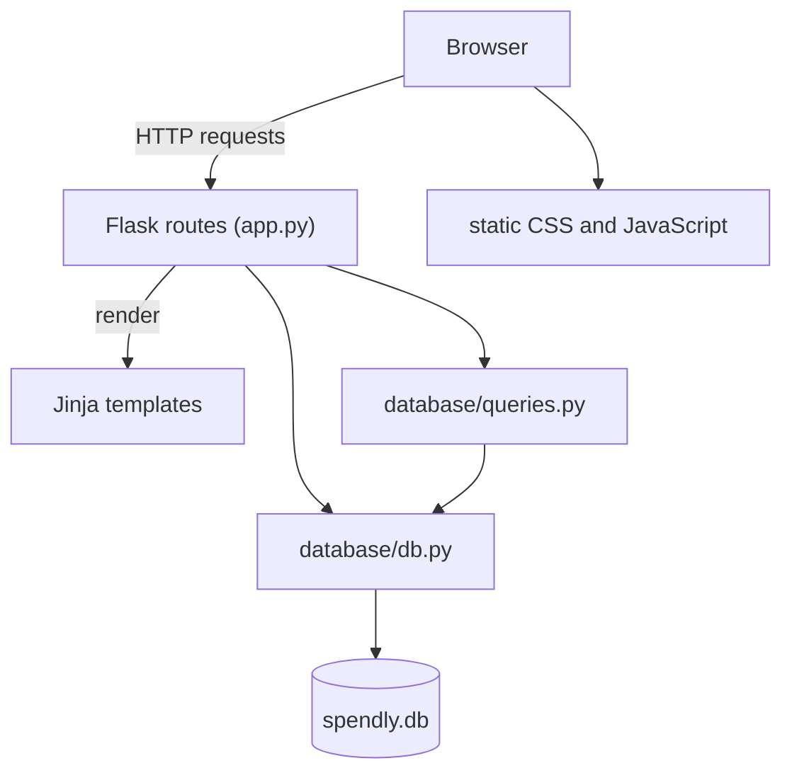

# Spendly

A lightweight personal expense tracker for recording purchases and reviewing spending by category and date. Spendly is built with Flask and SQLite, with a server-rendered interface and no JavaScript framework.

<p align="center">
  <a href="https://spendly-copy.onrender.com">
    
  </a>
</p>

<!-- ## Live Demo

[Open Spendly](https://spendly-copy.onrender.com). The homepage responded when checked while this README was prepared; availability may change. -->

## Features

- Create an account and sign in.
- Add expenses with an amount, category, date, and optional description.
- Review totals, transaction counts, recent transactions, and category spending on the profile page.
- Filter the profile by all time, this month, the previous three or six months, or an inclusive custom date range.
- Edit and delete expenses belonging to the signed-in user.
- Browse informational Terms and Privacy pages.

Expense amounts are displayed in Indian rupees (₹). The Analytics page is currently a “Coming Soon” placeholder, not an analytics dashboard.

## Technology

- Python 3.12+
- Flask 3.1.3 and Werkzeug 3.1.6
- SQLite
- Jinja templates, HTML, and CSS
- Vanilla JavaScript
- pytest and pytest-flask for tests

Runtime and test dependencies are listed in [`requirements.txt`](requirements.txt). The app also loads DM Sans and DM Serif Display from Google Fonts, and the landing-page explainer embeds a YouTube video.

## Architecture



`app.py` defines the routes and initializes the database when the application module is imported. `database/db.py` manages SQLite connections and schema creation; `database/queries.py` contains profile and expense queries. Templates extend `templates/base.html`, while styles and the small JavaScript asset live under `static/`.

## Prerequisites

- Python 3.12 or newer. The repository's `.python-version` specifies `3.12`, and `pyproject.toml` requires Python `>=3.12`.
- `pip` to install the dependencies.

No external database, API key, or service is required to run the application locally. SQLite is part of Python's standard library.

## Installation

From the repository root, create a virtual environment and install the pinned dependencies:

```shell
python -m venv .venv
```

Activate it, then install the requirements:

```powershell
# Windows PowerShell
.\.venv\Scripts\Activate.ps1
python -m pip install -r requirements.txt
```

```shell
# macOS / Linux
source .venv/bin/activate
python -m pip install -r requirements.txt
```

If PowerShell blocks activation, run the environment's interpreter directly:

```powershell
.\.venv\Scripts\python.exe -m pip install -r requirements.txt
```

<!-- ## Configuration

| Setting | Required? | Purpose |
| --- | --- | --- |
| `SECRET_KEY` | Set a strong value for any deployment; optional for local development | Signs Flask session cookies. If unset, the app uses the hard-coded development fallback `dev-secret-key-change-in-production`. |

PowerShell example:

```powershell
$env:SECRET_KEY = "replace-with-a-long-random-value"
```

macOS / Linux example:

```shell
export SECRET_KEY="replace-with-a-long-random-value"
```

The database file is `spendly.db` in the project root. The database helper uses that fixed path; there is no supported environment variable for changing it. -->

## Quick Start

After installation, start the local development server:

```shell
python app.py
```

Open [http://127.0.0.1:5001](http://127.0.0.1:5001). On startup, the app creates its SQLite tables and seeds sample records only if the database contains no users.

On a fresh local database, the seeded sample account is:

| Email | Password |
| --- | --- |
| `demo@spendly.com` | `demo123` |

Use this account only to explore a fresh database; do not enter personal or sensitive data into it. The app seeds any empty database regardless of environment, so configure production data and access deliberately. Create your own account through **Get started** to try the registration flow. Existing databases with users are not reseeded.

## Using Spendly

1. Register or sign in.
2. Choose **Add expense** on your profile and enter a positive amount, one of the available categories, a date, and optionally a description.
3. Review the profile summary and the latest 10 transactions. Use the date controls to filter the totals, transactions, and category breakdown together.
4. Select **Edit** or **Delete** beside a transaction to change or remove it. Deletion requires a confirmation page and a POST submission.

Available expense categories are Food, Transport, Bills, Health, Entertainment, Shopping, and Other. Descriptions are optional and limited to 200 characters.

## Web Routes

Spendly is a server-rendered web application; it does not expose a JSON API.

| Route | Methods | Behavior |
| --- | --- | --- |
| `/` | GET | Landing page |
| `/register` | GET, POST | Registration form and account creation |
| `/login` | GET, POST | Sign-in form and authentication |
| `/logout` | GET | Sign out |
| `/profile` | GET | Authenticated spending overview and date filters |
| `/expenses/add` | GET, POST | Authenticated expense creation |
| `/expenses/<id>/edit` | GET, POST | Edit an owned expense |
| `/expenses/<id>/delete` | GET, POST | Confirm and delete an owned expense |
| `/analytics` | GET | Authenticated “Coming Soon” page |
| `/terms` | GET | Terms and Conditions |
| `/privacy` | GET | Privacy Policy |

Unauthenticated requests to profile, expense, and analytics routes redirect to the sign-in page. The profile accepts `preset=all_time`, `this_month`, `last_3_months`, or `last_6_months`, or custom `start_date` and `end_date` query parameters in `YYYY-MM-DD` format. Custom date bounds are inclusive; invalid dates or a start date after the end date return HTTP 400.

## Project Structure

```text
.
├── app.py                    # Flask app, routes, and request validation
├── database/
│   ├── db.py                 # SQLite connection, schema, seed, and writes
│   └── queries.py            # Profile and expense data queries
├── templates/                # Jinja pages; base.html is the shared layout
├── static/
│   ├── css/                  # Shared and page-specific styles
│   └── js/main.js            # Vanilla JavaScript
├── tests/                    # pytest route and database tests
├── requirements.txt          # Pinned runtime and test dependencies
└── pyproject.toml            # Project metadata and Python requirement
```

## Tests and Other Commands

Run the test suite from the repository root with the environment activated:

```shell
python -m pytest
```

Run one test file or select tests by name:

```shell
python -m pytest tests/test_add_expense.py
python -m pytest -k "date_filter"
```

The repository does not define a separate lint, format, frontend build, or production-server command.

## Deployment

The configured Live Demo link points to [spendly-copy.onrender.com](https://spendly-copy.onrender.com), which returned the landing page when checked. The repository does not include deployment configuration or production-server instructions. `python app.py` starts Flask with debug mode enabled and is for local development, not production deployment.

Before deploying, configure a strong `SECRET_KEY` and a durable storage location for SQLite data. The application currently stores the database at a fixed path inside the project directory; hosting environments with ephemeral filesystems may lose data across restarts or deployments.

## Troubleshooting

- **`ModuleNotFoundError` when starting the app:** Activate the virtual environment and install dependencies with `python -m pip install -r requirements.txt`.
- **Python version errors:** Use Python 3.12 or newer, as specified by `.python-version` and `pyproject.toml`.
- **Port 5001 is already in use:** Stop the other local process using that port before running `python app.py`; the port is fixed in the app entry point.
- **The sample login does not work:** The sample account is inserted only when the database has no users. If this database has been used before, register an account or use an existing one; the app does not reset stored data on startup.
- **Changes to the source do not change the sample database location:** The SQLite helper uses the project-root `spendly.db` path rather than Flask's `DATABASE` setting.

## Contributing

There is no separate contribution guide in the repository. For changes, keep routes in `app.py`, SQLite logic in `database/`, pages in Jinja templates extending `base.html`, and browser code in vanilla JavaScript. Add or update focused pytest tests for behavior changes and run `python -m pytest` before submitting a contribution.

## Security Notes

- Set `SECRET_KEY` to a long, unique value outside local development; never rely on the built-in development fallback in a deployed app.
- The application starts with Flask debug mode enabled, so do not expose `python app.py` as a production server.
- The app hashes account passwords with Werkzeug. Do not use the seeded demo credentials for personal or sensitive data.
- Review the app's [Privacy Policy](templates/privacy.html) and hosting configuration before entering real financial information. The repository does not include production deployment hardening settings.

## License

No license file is present in the repository, so the project's license and reuse terms are not specified.